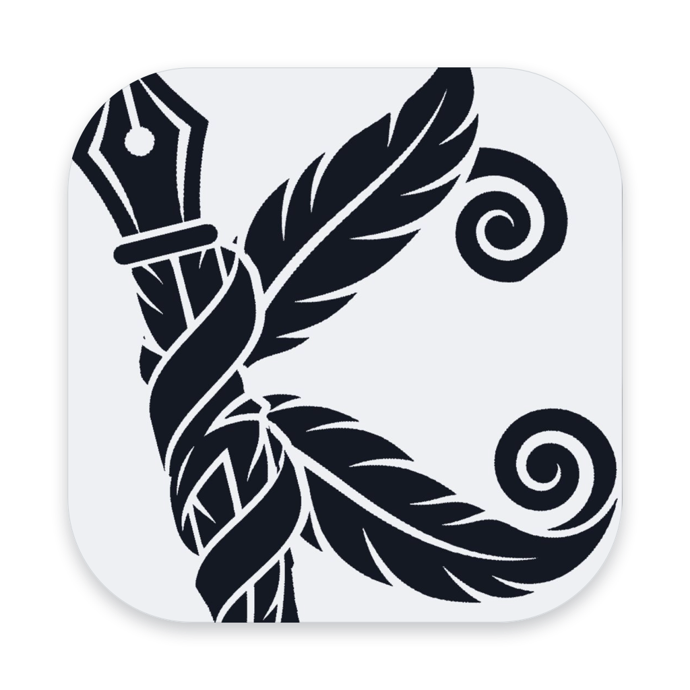

<p align="center">
  
</p>

<h1 align="center">Kadmos</h1>

<p align="center">
  <strong>A native macOS plain-text editor and Liquid Glass UI (macOS 26+).</strong><br/>
  Built with pure AppKit and SwiftUI to feel like a first-party Apple application.
</p>

<p align="center">
  <a href="https://github.com/berkaroon/Kadmos/raw/main/dist/Kadmos.dmg">
    
  </a>
  
  
  <a href="LICENSE">
    
  </a>
</p>

---

## Download & Install

- **Direct Download:** [**Kadmos.dmg**](https://github.com/berkaroon/Kadmos/raw/main/dist/Kadmos.dmg) (`3.6 MB`, Universal `arm64 + x86_64`)
- **SHA-256:** `61fbb9227ce999212380ba507fbed1b89c2dc0d4e85a3ab1ee9f43689a858133`

### Installation Steps
1. Open **`Kadmos.dmg`** and drag **Kadmos.app** into your **Applications** folder.
2. **First Launch (Gatekeeper):** Because Kadmos is distributed independently with an ad-hoc signature rather than a paid Apple Developer ID certificate, macOS may show an *"unverified developer"* warning the first time you open it. Open **System Settings → Privacy & Security**, scroll down, and click **Open Anyway**.
3. **Desktop Right-Click ("New Kadmos Document"):** Enable **Kadmos Finder** under **System Settings → General → Login Items & Extensions → Finder Extensions**. Once enabled, right-clicking on your Desktop or inside any Finder folder lets you create a new document directly in that folder (or open selected files in Kadmos).

---

## Features

### Native macOS & Liquid Glass Experience
- **Safari-Style Unified Tab Strip:** Integrated directly into a `40 pt` transparent titlebar aligned with macOS traffic lights, featuring native **Liquid Glass** (`GlassEffectContainer` & `.glassEffect`) on **macOS 26+** with native frosted material fallback on **macOS 15 Sequoia**, and full-bleed text scrolling smoothly underneath.
- **Inline Tab & Extension Renaming:** Click the title of any active tab (for example `Adsız 1` → `adsız1.txt`), type a new name and extension (`deneme.yml`), and confirm with the inline **Onayla** button or `Return`. Spell-check rules and Save dialogs adapt to the new extension immediately.
- **First-Party Apple Polish:** Pure AppKit `NSTextView` (TextKit 1) editor with **Apple Writing Tools**, VoiceOver support, native Print & Page Setup (`⌘P`, `⌘⇧P`), trackpad pinch-to-zoom, and `⌘ + scroll` zooming.

### Plain-Text Parity
- **Tabs, Windows & Session Restore:** Multi-tab (`⌘N`), multi-window (`⌘⇧N`), reopen closed tabs (`⌘⇧T`), drag-to-reorder tabs, tab duplication, move tab to new window, and automatic session & unsaved draft persistence across restarts.
- **Floating Find & Replace:** Case sensitive (`Aa`), whole word (`ab`), wrap-around (`↻`), and timeout-protected Regular Expressions (`.*`) with match counters (`⌘F`, `⌥⌘F`, `⌘G` / `F3`, `⌘⇧G` / `⇧F3`) — rendered with Liquid Glass on macOS 26+ and frosted material on macOS 15.
- **Classic Notepad Utilities:** Go To Line (`⌘L`), Insert Time/Date (`F5`), Word Wrap (`⌥Z`), Zoom (`10%–500%`), and right-click **Search Web** in your default browser.
- **Status Bar & Text Encodings:** Live Line/Column indicator, character/selection/word counts, line-ending switcher (`LF`, `CRLF`, `CR`), and lossless/reopen support across 8 encodings (`UTF-8`, `UTF-8 BOM`, `UTF-16 LE`, `UTF-16 BE`, `Windows-1254`, `Windows-1252`, `ISO Latin 1`, `Mac OS Roman`).
- **Customization:** System / Light / Dark appearance, customizable Font family/style/size with live preview, and live spell check / autocorrect with per-extension exclusions for code and config files.

### Lightweight, Offline & Safe by Design
- **100% Offline & Sandboxed:** Zero network entitlements, zero telemetry, and zero third-party package dependencies—built purely on Apple system frameworks (`AppKit`, `SwiftUI`, `FinderSync`, `UniformTypeIdentifiers`, `OSLog`).
- **Large File Protection:** Opens files above `50 MB` in performance-guarded limited mode and streams files above `1 GB` in bounded `256 KB` read-only chunks.
- **Invisible Character Visibility:** Highlights bidirectional (Bidi) and zero-width Unicode control characters by default so hidden characters never slip past unnoticed.

---

## Build from Source

### Requirements
- **macOS 15.0+** (compatible with macOS 15 Sequoia, macOS 26 Tahoe, and macOS 27 Golden Gate; Liquid Glass UI enabled on macOS 26+)
- **Xcode 27.2+** (`Swift 6.0+`)

### Run Tests (`KadmosCore`)
```bash
swift test
```

### Build, Sign & Package `Kadmos.app` and `Kadmos.dmg`
```bash
./scripts/build_app.sh
```
This runs the full `KadmosCoreTests` suite, generates `Kadmos.xcodeproj`, compiles a Release build, signs `KadmosFinderSync.appex` and `Kadmos.app` inside-out with Hardened Runtime, verifies signatures and entitlements, and outputs `dist/Kadmos.app` and `dist/Kadmos.dmg`.

---

## Project Structure

```text
Kadmos/
├── Assets/                  # App icons (.icns, PNGs) and custom logo artwork
├── Config/                  # Entitlements and Info.plist manifests
├── Sources/
│   ├── KadmosCore/          # Encodings, line endings, safe I/O, ReDoS-safe search, Trojan scanner, session vault
│   ├── KadmosApp/           # SwiftUI + AppKit editor UI, Safari-style Liquid Glass tabs, settings
│   └── KadmosFinderSync/    # Embedded Finder right-click extension (.appex)
├── Tests/KadmosCoreTests/   # Unit and hardening test suite (33 tests)
├── dist/                    # Prebuilt Kadmos.dmg installer
├── scripts/                 # Xcode project generator and build/signing scripts
└── Package.swift
```

---

## Issues & Feedback

Encountered a bug, having trouble with the Finder extension, or want to suggest a feature?  
Please open a ticket on [**GitHub Issues**](https://github.com/berkaroon/Kadmos/issues).

---

## License

Released under the [MIT License](LICENSE).
